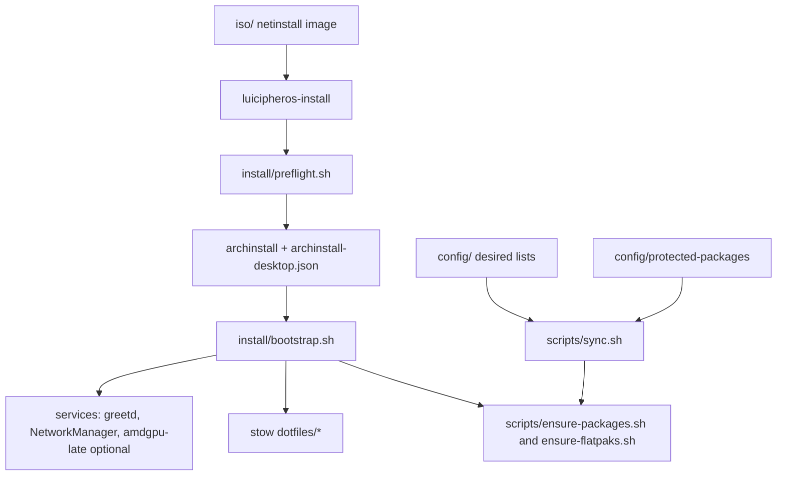

# Project Overview

LuicipherOS is an Arch-based, Hyprland-first, keyboard-driven OS configuration: dotfiles, an
`archinstall` profile, a bootstrap flow and declarative package lists, reconciled by `luci sync`.
It is not a forked distro in v0.1. Elevator pitch: NixOS-style declarative apps (edit a list,
sync realizes it) on plain Arch, with a SUPER-key desktop (Hyprland native Lua, Vicinae,
Quickshell, Tabby, Gradia). v0.1 is tuned for one target machine (Ryzen 5 9600X + ASUS TUF GAMING
B650E-PLUS WIFI + RX 7900 XT 20GB) and tested in a QEMU/OVMF VM.

Current status (from `TESTING.md`, git history and session reports through 2026-11-03):

- VM smoke and ISO-loop PASS (2026-09-26, 2026-09-28; re-verified Oct 2026).
- The target desktop runs LuicipherOS (user-reported); `luci sync` has never been run on it.
- Open boot/GPU issue on the 7900 XT: amdgpu storms (DMUB/SMU errors) when loaded early in
  boot on kernel 7.2.11; manual late loading is the interim workaround. On Nov 3 the first
  amdgpu PCI-device message was at 415.378081 s uptime and the user reached the desktop;
  the error-check result was not reported. Tracked in issue #11 and
  `docs/dmub-coldboot-casefile.md`.
- A separate blank-start symptom is tracked in issue #11: blank starts were reported on
  Oct 31, Nov 1 and Nov 3; Nov 2 was normal. A hard power-off followed by another start
  restored the picture in the reported blank-start cases. Cause and relation to amdgpu
  remain UNCONFIRMED.
- Compatibility claim stays limited until target + AMD laptop + Intel laptop + VM all pass
  (ADR-0001).

## Operational Metadata

- Unified Agent Prompts version: `v1.0` (initialized 2026-11-10).
- Prompt source: "Project Documentation & Maintenance" prompt (AGENTS.md + CONTINUITY.md).
- Documentation reference: this file is the canonical blueprint; operational history lives in
  `.agent/CONTINUITY.md`; vocabulary lives in `CONTEXT.md`.
- Project version: v0.1 (draft), per `README.md`.
- Last documentation sync: 2026-11-03 (session-report update; previous code review against
  commit `1a41e82`, not a fresh full-repository audit).
- Issue tracker: GitHub Issues via `gh` CLI (`docs/agents/issue-tracker.md`). Issue #1 (v0.1)
  is closed. Open boot/GPU issue: #11.
- Triage labels: five canonical roles mapped 1:1 to label strings
  (`docs/agents/triage-labels.md`).
- Domain docs: single-context layout, `CONTEXT.md` + `docs/adr/` (`docs/agents/domain.md`).
- Two working copies exist and are intentional: `/home/work/LuicipherOS` is the deployed copy
  whose stow symlinks are live in `~/.config`, and the development clone is where changes are
  authored. Dotfile edits made in the dev clone do not reach the running desktop until they are
  committed and pulled (or copied) into the deployed clone. Never edit the deployed clone by
  assumption.

## Repository Structure

```
LuicipherOS/
├── .agent/CONTINUITY.md   # operational log (this documentation task)
├── .agents/skills/        # agent skills (pinned by skills-lock.json)
├── .opencode/             # local OpenCode plugin/session state (sessions gitignored)
├── AGENTS.md              # this blueprint
├── CONTEXT.md             # glossary + locked decisions
├── README.md              # user-facing overview, install, roadmap
├── TESTING.md             # test matrix and smoke results
├── LICENSE                # MIT
├── skills-lock.json       # lockfile for agent skills
├── config/                # desired lists: packages, AUR, flatpaks, protected packages
├── desktop/               # target-machine hardware report
├── docs/                  # ADRs, agent docs, troubleshooting, runbooks, case files
├── dotfiles/              # GNU Stow packages for the desktop
├── install/               # archinstall JSON, preflight, bootstrap, boot-time units
├── iso/                   # archiso netinstall profile
├── research/              # background research notes
├── scripts/               # sync and ensure-* reconcilers, screenshot helper
└── tests/                 # shell tests (currently test_sync.sh)
```

- `.agents/` holds agent skills; do not hand-edit what `skills-lock.json` pins.
- `config/` is the source of truth: `packages`, `packages-arch`, `flatpaks-system.list`,
  `flatpaks-user.list`, `protected-packages` (`flatpaks.list` is legacy, system scope).
- `desktop/` holds `Detailed_PC_Report_Without_Submetrics.txt`.
- `docs/` holds `adr/`, `agents/`, `wiki-draft/`, `TROUBLESHOOTING.md`,
  `target-bringup-runbook.md`, `hyprcapture-trial.md`, `dmub-coldboot-casefile.md`,
  `upstream-drm-amd-coldboot-dmub.md`.
- `dotfiles/` has `fuzzel`, `hypr`, `quickshell`, `swaync`, `tabby`, `termfilechooser`, `uwsm`,
  `vicinae`, `xdg`.
- `install/` has `archinstall-desktop.json`, `archinstall-desktop.creds.example.json`,
  `bootstrap.sh`, `preflight.sh`, `greetd-config.toml`, `vconsole.conf`, `amdgpu-late.service`.
- `iso/` has `profiledef.sh`, `packages.x86_64`, `airootfs/`, `README.md`.
- `research/` currently has `office-suites.md`.
- `scripts/` has `sync.sh`, `ensure-packages.sh`, `ensure-flatpaks.sh`, `screenshot-window.sh`.

## Build & Development Commands

Target OS is Arch Linux. Static checks run anywhere with bash and python3.

1. Static checks (no Arch needed):

```bash
bash -n scripts/*.sh install/*.sh && echo STATIC-OK
python3 -m json.tool install/archinstall-desktop.json > /dev/null && echo JSON-OK
python3 -m json.tool install/archinstall-desktop.creds.example.json > /dev/null
./scripts/sync.sh --prune --dry-run
```

2. Install on a fresh Arch live environment:

```bash
chmod +x scripts/*.sh install/*.sh
./install/preflight.sh --vm        # or --target on the 7900 XT box
# EDIT-ME: install/archinstall-desktop.json (device, hostname, timezone)
cp install/archinstall-desktop.creds.example.json /tmp/creds.json   # fill hashes, never commit
archinstall --config install/archinstall-desktop.json --creds /tmp/creds.json
./install/bootstrap.sh             # preflight -> packages -> stow -> flatpaks -> services
```

3. Reconcile packages (manual only, never automatic):

```bash
./scripts/sync.sh                    # install missing only
./scripts/sync.sh --prune --dry-run  # preview extras
./scripts/sync.sh --prune            # remove extras (confirms; honors protected-packages)
```

4. Build the netinstall ISO (on Arch with `archiso`):

```bash
sudo pacman -S --needed archiso
cp /etc/pacman.conf iso/pacman.conf
cp -r /usr/share/archiso/configs/releng/syslinux iso/syslinux
cp -r /usr/share/archiso/configs/releng/efiboot iso/efiboot
sudo mkarchiso -v -w /tmp/luici-iso-tmp -o out/ iso/
```

5. Lint, formatter, package manager for the repo itself: > TODO: none configured beyond
   `bash -n`. [NEEDS TEAM INPUT] (e.g. shellcheck, shfmt).

6. Target-machine maintenance (installed Arch desktop, run as the admin account):

```bash
sudo pacman -Syu                  # always a FULL upgrade; never install single packages first
sudo snapper -c root list         # snap-pac takes pre/post snapshots around pacman runs
sudo bootctl update               # after systemd upgrades
sudo umount /boot && sudo fsck.fat -n /dev/nvme0n1p1; sudo mount /boot   # ESP check
```

## Code Style & Conventions

- Languages: Bash (scripts, installer), JSON (archinstall), Lua (Hyprland), QML (Quickshell),
  Markdown (docs). > TODO: document formatting rules per language. [NEEDS TEAM INPUT]
- Hyprland config is native Lua only: `hyprland.lua` plus `lua/` modules loaded with
  `require()`. The hyprlang `.conf` format is deprecated since 0.55 and dropped in 0.57; do
  not add it.
- uwsm users keep environment in `~/.config/uwsm/env` and `~/.config/uwsm/env-hyprland`.
- Dotfiles are GNU Stow packages under `dotfiles/`; root-owned files (e.g. greetd config)
  are not stowable and are deployed by `install/bootstrap.sh`.
- Shell pipelines under `set -o pipefail`: avoid `grep -q` on the right of a pipe (SIGPIPE
  false failures). Fixed twice already in the PCI check and AMD gate.
- Functions run inside `$(...)` must send prompts and chatter to stderr, never stdout.
- Commit messages: Conventional Commits style (`feat:`, `fix:`, `docs:`, `chore:`) with a
  `Refs #N` or `Closes #N` footer.
- Config strictness: `install/archinstall-desktop.json` must match the CURRENT archinstall
  parser (verified on the 2026.09.01 ISO). Rules:
  1. `size`/`start` need a `sector_size` object (`{"unit": "B", "value": 512}`), never null.
  2. `unit` is a fixed enum; there is no Percent or fill-remaining value. Use explicit GiB.
  3. The ESP needs flags `["boot", "esp"]`; `boot` alone is not recognized.
  4. Keep `"silent": false` for first runs so a human reviews disk and users.
- Package names are exact: use `greetd-tuigreet`, not `tuigreet`.
- Browser: `helium-browser-bin` only; Firefox is removed everywhere.
- Kernel parameters for the late-load route: use `modprobe.blacklist=amdgpu` (stops automatic
  loading only). `module_blacklist=amdgpu` blocks even a manual `modprobe` (Operation not
  permitted) and breaks the workflow. Hard-block is for pure recovery boots.
- The systemd-boot editor (`e` in the menu) uses a US keyboard layout, whatever the OS layout.
- To locate the first amdgpu PCI-device message, use
  `journalctl -k -b -o short-monotonic --no-pager | grep -m1 'amdgpu 0000'`.
  The earlier `amdgpu.*(probe|initializ)` grep matched the kernel command line instead.
  A first device message is not evidence of completed initialization or an error-free boot.

## Architecture Notes



Desired lists in `config/` declare intent; `luci sync` (`scripts/sync.sh`) realizes it. Default
mode installs missing packages only and never touches dependencies (`-Qqd`). `--prune` also
removes extras after a preview and confirmation, and never removes anything in
`protected-packages` (kernel, firmware, drivers, compositor, networking). Prune compares only
explicitly installed pacman packages and flatpak apps; hand-installed binaries, AppImages and
language-tool installs are never touched. System and user flatpak scopes prune independently,
and the user scope depends on which account runs the script. Sync is manual-only by design:
no auto-sync on boot.

Desktop stack (locked in v0.1): Hyprland (>= 0.55, native Lua) under uwsm, greetd + tuigreet
login, Vicinae launcher on SUPER+Space (fuzzel fallback), custom Quickshell bar and plugin
host, swaync notifications (kept until the shell has its own center), Tabby terminal,
grim + slurp -> Gradia screenshots, GTK portal file picker (termfilechooser + yazi is opt-in).
Hyprland, lock screen, portals and drivers stay pacman-owned because of PAM/SUID and GL traps.
Session start: the repo greetd command runs `uwsm start hyprland`, which prints a 5 second
warning; the "Hyprland (uwsm managed)" session does not. Default to be decided (issue #11).

Disk layout on the target: LUKS + btrfs with subvolumes `@`, `@home`, `@log`, `@pkg`,
`@snapshots`, systemd-boot (per `docs/dmub-coldboot-casefile.md`). The ESP is FAT on
`/dev/nvme0n1p1`, mounted at `/boot`, outside Btrfs, and is not covered by snapshots. Kernels
and initramfs live there. Snapper config `root` snapshots `/` into `/.snapshots` (`@snapshots`);
snap-pac adds pre/post snapshots around pacman. Snapshots are not backups (same disk).

Boot entries on the desktop: the user reports selecting the default late-load entry on
2026-11-03 (called `arch-lateload` in the session). Its supplied command line includes
`amdgpu.runpm=0 modprobe.blacklist=amdgpu systemd.mask=amdgpu-late.service 3`.
The exact entry filename and persistent default setting have not been independently read.
Previously recorded entries are `linux` (options include `amdgpu.runpm=0`; no amd-ucode
initrd listed) and `arch-lts` (loads amd-ucode; no `amdgpu.runpm=0`). Menu timeout is 10 s
(`bootctl set-timeout 10`); the original timeout was 0 (hold Space to show the menu).

GPU bring-up workaround (interim, issue #11): boot with `modprobe.blacklist=amdgpu
systemd.mask=amdgpu-late.service 3`, log in on a text console, wait about 190 s of uptime,
`sudo modprobe amdgpu`, confirm no `Error queueing DMUB`/`Failed to power gate` lines in
`dmesg`, then `sudo systemctl start greetd`. Hypothesis, not proven: the GPU needs time since
power-on or a quieter boot before the driver initializes it.

Blank-start observations (issue #11): before considering a hard power-off, record whether
Caps Lock responds, whether a monitor-only power cycle restores the picture, and whether
another HDMI input/port helps. Do not equate a black screen with an unresponsive computer.
Prefer a clean shutdown when possible. On recovery, record `journalctl --list-boots | tail -3`
and `uptime -s`. Absence of a separate saved boot does not prove that the kernel never ran.

The ISO is a netinstall image: packages are never baked in, so every install gets current
packages. Fixes to `luicipheros-install` reach a booted ISO only via `git pull` plus a copy
(see `iso/README.md`).

Decision record: ADR-0001 locks Arch + scripts. Nix is an optional v0.3 layer; LFS is a
learning side-quest only.

## Testing Strategy

- Static: `bash -n`, `python3 -m json.tool`, `sync.sh --prune --dry-run` (see TESTING.md §0).
- Unit/regression: `tests/test_sync.sh` covers the sync contract. > TODO: confirm how to run it
  and whether it needs Arch; add it to the documented commands. [NEEDS TEAM INPUT]
- VM smoke: QEMU/OVMF, Arch ISO, 4G RAM, 60G disk. PASS means Hyprland (uwsm) loads,
  SUPER+T opens Tabby, SUPER+Space opens Vicinae, Quickshell bar and swaync are visible, and
  Print -> region -> Gradia works.
- ISO loop: boot the built ISO, run `luicipheros-install --vm`; reaching `archinstall` is PASS.
- Target machine: `./install/preflight.sh --target`, then the ROCm/desktop verification list in
  `TESTING.md` §2 (`rocminfo`, PyTorch ROCm, Blender HIP, Ollama, `lpstat -p`, `hyprctl version`).
- Target boot checks (issue #11): after a boot, `lsmod | grep amdgpu`, then
  `sudo dmesg | grep -ciE 'Error queueing DMUB|Failed to power gate'` must print 0. Test one
  change per attempt (normal boot with the enabled unit, delay variant, firmware retest).
- Blank-start checks: record Caps Lock, monitor-only power-cycle and other-HDMI results.
  Nov 3 results were not reported. DisplayPort and changes to the shutdown path remain
  proposed tests, not established fixes; do not unload a live display driver as a routine step.
- Dev station: libvirt/QEMU VM for installer and boot tests, Podman container for script
  tests. Install status of the QEMU stack on the desktop: UNCONFIRMED.
- Sync contract: install missing only; `--prune --dry-run` previews; `--prune` confirms unless
  `--yes`; honors `protected-packages`; scopes prune independently.
- CI: none yet (planned for v0.3: CI + VM test matrix).

## Security & Compliance

- Secrets: never commit credentials. Copy `archinstall-desktop.creds.example.json` to
  `/tmp/creds.json` and fill password hashes (`openssl passwd -6`). Do not commit hashes.
- Ignored artifacts (`.gitignore`): `iso/pacman.conf`, `iso/syslinux`, `iso/efiboot`, `out/`,
  `screenshotVM/`, `docs/*.pdf`.
- Disk encryption: LUKS on the target. SecureBoot is out of scope for v0.1.
- Privileged paths: PAM/SUID components (lock screen, keyring, greetd) stay system packages.
- AUR surface is kept tiny (yay-bin, vicinae-bin, helium-browser-bin, tabby-bin); review any
  addition.
- Containers: membership in the `docker` group is root-equivalent. Prefer rootless Podman
  (installed). Docker engine presence on the desktop is UNCONFIRMED; `docker-compose` is.
- Hard power-offs can leave the FAT ESP dirty; keep `dosfstools` installed (`fsck.fat`) and
  prefer clean shutdowns. Do not prescribe unconditional automatic repair. Any filesystem
  check or repair must target the verified device with the filesystem unmounted; review a
  read-only check first and obtain explicit approval before repairs.
- mkinitcpio >= 42: Arch news says TPM2-based LUKS unlocking needs manual intervention.
  > TODO: confirm whether TPM2 unlock is used before upgrading mkinitcpio. [NEEDS TEAM INPUT]
- Dependency scanning: > TODO: none configured. [NEEDS TEAM INPUT]
- Secret scanning: > TODO: none configured in CI. Scan diffs manually before pushing.
- License: MIT (`LICENSE`) covers original files. Third-party software installed via the lists
  keeps its upstream licenses. Not an official Arch product.

## Agent Guardrails

- Never commit secrets, credentials, password hashes, or local artifacts (VM screenshots,
  runbook PDFs, ISO outputs). Concretely, never touch or commit `screenshotVM/` (gitignored),
  `docs/*.pdf`, `.opencode/sessions/`, or `/tmp/creds.json`.
- Never run `sync.sh --prune` (without `--dry-run`) on a user's live machine, `mkarchiso` without
  an explicit request, `pacman -Rns` outside the guarded prune path, or partition-writing commands
  against a physical disk. Dry-run and confirm first.
- Never enable auto-sync on boot or add a unit that runs `sync.sh`; manual-only is LOCKED.
- Never remove or weaken `config/protected-packages`, or make `--prune` run without preview
  and confirmation.
- Do not run `luci sync --prune` on the desktop until the extras inventory is done and the
  dev-tool packages are in `config/packages` (see CONTINUITY.md). Run `sync.sh` as the daily
  account (`work`), never as root; `luci` is the admin account.
- Never re-add Firefox, waybar, kitty, or swappy; they were deliberately removed.
- Never add hyprlang `.conf` Hyprland configs.
- Do not edit `.agents/skills/**` or vendored skill content unless the task is explicitly about
  skills; treat them as read-only snapshots pinned by `skills-lock.json`.
- Preserve locked decisions (see `CONTEXT.md`): Vicinae primary + fuzzel fallback, Quickshell bar,
  Tabby, swaync until a shell notification center exists, manual-only sync, pacman-owned compositor
  and portals. Reopen only with an explicit user decision and a new/updated ADR.
- Do not run `archinstall`, `sync.sh --prune`, `mkarchiso`, or anything writing to disks, on
  the host without an explicit user instruction.
- `amdgpu-late.service` is ENABLED on the desktop (earlier docs said disabled). Do not change
  its enablement or content without an explicit instruction; see issue #11.
- Do not edit the ESP (`/boot/loader/entries`, `loader.conf`) without an explicit instruction.
  Never use `module_blacklist=` for the late-load route (use `modprobe.blacklist=`).
- Always run a full `pacman -Syu` before installing any single package; take or confirm a
  Snapper snapshot first.
- Do not recommend hard power-offs unless the machine is unresponsive; prefer clean shutdowns.
  A black screen alone does not establish unresponsiveness; record the diagnostic checks first.
- Do not publish the ISO under Releases until a VM boot reaches archinstall (see `iso/README.md`).
- Do not claim broad hardware compatibility before the matrix passes (ADR-0001).
- Record unverified claims as `> TODO:` or `[NEEDS TEAM INPUT]`; mark target-only results as
  unverified until tested on the target.
- Required reviews: > TODO: no review policy or branch protection (main is unprotected).
  [NEEDS TEAM INPUT]
- Rate limits: > TODO: none defined.
- Log architectural changes in `.agent/CONTINUITY.md` and, when decisions change, in a new ADR.
- Issue tracking uses `gh`; infer the repo from `git remote -v`.

## Extensibility Hooks

- Desired lists in `config/`: add a package or flatpak by editing the list, then `luci sync`.
- Preflight modes: `install/preflight.sh --vm | --target`; bootstrap
  `--preflight-mode=vm|target` and `--no-flatpak`.
- `scripts/sync.sh` flags: `--prune`, `--dry-run`, `--yes`; AUR helper flag (yay-bin default,
  paru supported).
- Quickshell plugin host: `dotfiles/quickshell/plugins/` for ported Noctalia,
  DankMaterialShell and Omarchy widgets.
- Opt-in features: termfilechooser + yazi portal picker (dormant), HyprCapture screenshot trial
  (`docs/hyprcapture-trial.md`), `amdgpu-late.service` (AMD hardware only).
- Kernel parameters in use: `amdgpu.runpm=0` (default entry), `modprobe.blacklist=amdgpu`,
  `systemd.mask=amdgpu-late.service`, `3` (text login). `/etc/modprobe.d/amdgpu-coldboot.conf`
  holds the soft blacklist on the desktop.
- Late-load entry: user reports booting the default entry on 2026-11-03; supplied parameters
  match the workaround. Read `bootctl list` and loader configuration before claiming the
  exact filename or independently verified persistent default setting.
- Planned: hardware profiles under `profiles/` (v0.2), optional Nix layer (v0.3).
- Environment variables: `AQ_DRM_DEVICES` (per-machine, planned via profiles). Feature flags:
  > TODO: none documented. [NEEDS TEAM INPUT]

## Further Reading

- `README.md` – overview, install, roadmap.
- `CONTEXT.md` – glossary and locked decisions.
- `docs/adr/0001-arch-vs-nixos.md` – why Arch + scripts.
- `TESTING.md` – test matrix and results.
- `docs/TROUBLESHOOTING.md` – FAQ from smoke failures (includes the DMUB cold-boot entry).
- `docs/target-bringup-runbook.md` – hardware-day plan.
- `docs/dmub-coldboot-casefile.md` and `docs/upstream-drm-amd-coldboot-dmub.md` – open GPU issue.
- Issue #11 – Oct 31 timeline, findings, workaround and checklist; Nov 3 blank-start update.
- `docs/hyprcapture-trial.md` – reversible screenshot-tool trial.
- `docs/agents/` – issue tracker, triage labels, domain docs.
- `iso/README.md` – ISO build and test.
- archinstall: https://archinstall.archlinux.page/ and
  https://github.com/archlinux/archinstall/blob/master/archinstall/lib/models/device.py
- archinstall man page: https://man.archlinux.org/man/archinstall.1.en
